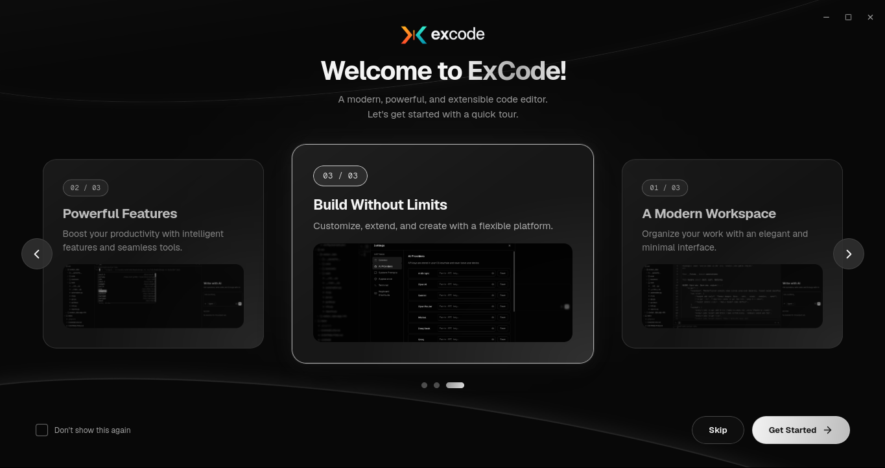
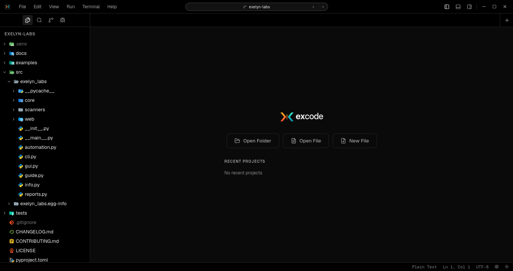
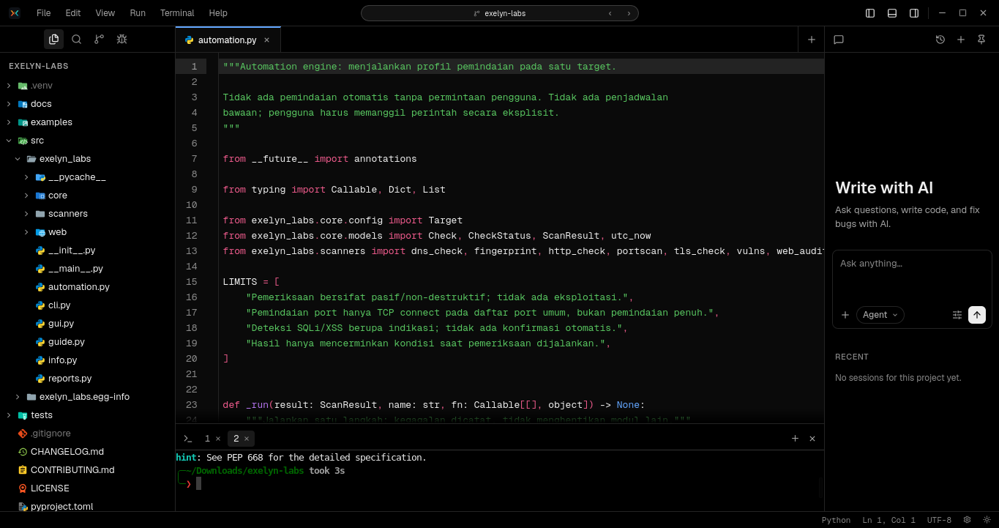
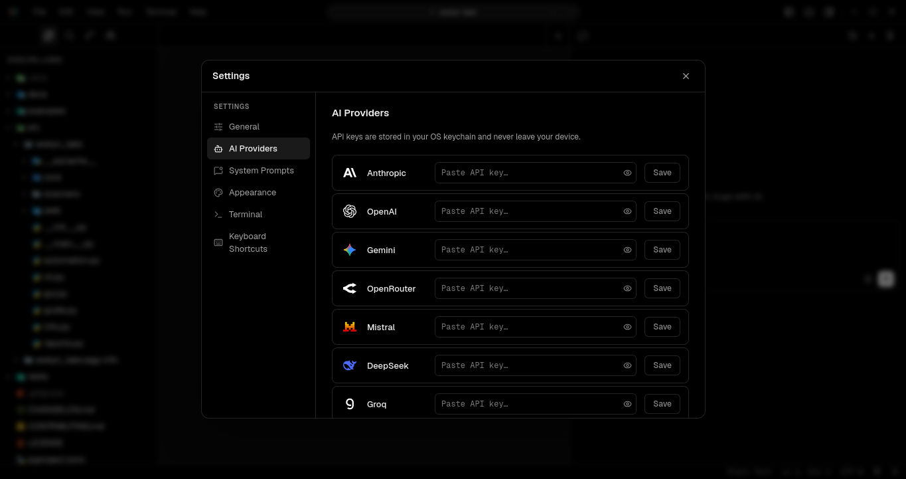

# EXCODE

EXCODE is a Linux desktop code editor designed to keep everyday development in one place.

Open a project, work across files, use the integrated terminal, and access developer tools without constantly switching applications.

## Preview

